# capgate · 本地能力网关

A resident local gateway that decides which domain environments a task pulls, which agent and
model each environment runs, and records the whole decision chain where you can read it.

一个常驻本地的能力网关：它决定一个任务该拉哪几个领域环境、每个环境用哪个 Agent 的哪个模型，
并把每次的决策链摊开给你看。




<sub>Generated by `tools/make-demo.mjs` from real CLI output; task ids and latencies are normalized so the image stays stable.<br/>由 `tools/make-demo.mjs` 用真实 CLI 输出渲染；任务 id 与时延已归一化，保证图不会每天变。</sub>

## How to read · 怎么读

English first, Chinese immediately after, in the same section — this is one document, not a translation pair.

英文在前、中文紧跟，在同一节里——这是一份文档，不是两个版本。

## At a glance · 一眼看懂

|  |  |
|---|---|
| **Problem**<br/>问题 | Agents own the loop, so every session re-grows its prompt, and nobody knows which tool combination actually works.<br/>Agent 拥有循环，提示词每会话重长一遍，也没人知道哪个工具组合真的有效。 |
| **Approach**<br/>做法 | Move the loop into a resident gateway. Environments own capabilities; agents become things the gateway calls.<br/>把循环搬进常驻网关。环境拥有能力，Agent 变成被网关调用的东西。 |
| **Cost**<br/>代价 | One more trust boundary, one more single point of failure, and a state model you have to operate.<br/>多一个信任边界、多一个要运维的单点，还有一套得自己运营的状态模型。 |
| **Not**<br/>不是 | Not an agent framework, not a hosted service, not a tool marketplace.<br/>不是 Agent 框架，不是云服务，不是工具市场。 |

## The problem · 问题

One agent, eight MCP servers, three months of history — and two questions nobody can answer:
why do we barely use those MCPs, and which pairing is actually good?

一个 Agent 拖着 8 个 MCP 跑了三个月，有两个问题谁都答不上来：为什么这些 MCP 基本没被用，
以及到底哪个组合真的好。

The old shape has no place to put the answer:

旧形态没有一个地方能放下这个答案：

```
one-agent-one-honeycomb/
├── agent/              # prompt rebuilt per session · 提示词每次会话重建
├── mcp-a/ mcp-b/ ...   # used by whom, how often? unknown · 谁用过、用了几次？不知道
└── no ledger           # why this choice? unrecoverable · 为什么这么选？无从复盘
```

capgate puts the answer in three places — a versioned capability pool, domain environments that
declare contracts, and a ledger every decision lands in:

capgate 把答案放进三个地方——带版本的能力池、声明契约的领域环境、每次决策都落进去的账本：

```
capgate/
├── capabilities/       # versioned parts, shared · 有版本的零件，可共享
├── envs/               # business domains, not tech layers · 业务域，不是技术层
├── var/capgate.db      # decision chain + outcomes · 决策链与结果
└── selfhost/           # builds this repo, with this repo · 用本仓库构建本仓库
```

## Ideas · 思路

Four nouns carry the whole design. Each has exactly one rule.

整套设计由四个名词撑住，每个名词只配一条规则。

| Noun · 名词 | Rule · 规则 |
|---|---|
| **Capability**<br/>能力 | A versioned part: MCP server, RAG, in-process SDK function.<br/>一个有版本的零件：MCP server、RAG、进程内 SDK 函数。 |
| **Env**<br/>环境 | The only packaging unit: capabilities + agent + artifact contract + resource profile.<br/>唯一的封装单位：能力组合 + Agent + 产物契约 + 资源画像。 |
| **Artifact**<br/>产物 | The only channel between envs. Content-addressed, schema-checked, never passed in memory.<br/>环境之间唯一的通道。内容寻址、schema 校验，绝不靠内存传递。 |
| **Ledger**<br/>账本 | Routing scores are derived from it, never typed in. Human labels outrank run status.<br/>路由分数由它派生，绝不手填。人的验收标签压过运行状态。 |

## Capabilities · 能力清单

Every row below is a command you can run; `--help` on any of them is the source of truth.

下面每一行都是一条能跑的命令；任何一条加 `--help` 才是准的。

| Command · 命令 | What it does · 做什么 |
|---|---|
| `capgate doctor` | Checks deps, SQLite, and whether every env/capability loads.<br/>检查依赖、SQLite，以及每个 env/能力能否载入。 |
| `capgate probe <cap>` | Really connects to a capability and lists the tools it exposes.<br/>真连一次能力，列出它实际暴露的工具。 |
| `capgate call <cap> <tool>` | Calls the tool once and prints the real payload shape.<br/>调一次工具，打印真实返回形状。 |
| `capgate solve "<goal>" -t <tag>` | Routes a task, runs it, prints the decision chain.<br/>路由一个任务、执行、打印决策链。 |
| `capgate chain <task_id>` | Replays why a finished task went the way it did.<br/>复盘一个已完成任务为什么这么走。 |
| `capgate rate <task_id> --good\|--bad` | Records a human verdict; feeds back into routing.<br/>记录人工验收，直接喂回路由。 |
| `capgate stats` | Aggregates by `(env, adapter, model)`.<br/>按环境/适配器/模型聚合。 |
| `capgate envs` / `caps` | Lists domain environments and the capability pool.<br/>列出领域环境与能力池。 |
| `capgate demo -s <scenario>` | Offline end-to-end scenarios (`pipeline` / `branch` / `doc`).<br/>离线端到端场景。 |
| `capgate serve` | Local dashboard at `127.0.0.1:8787`.<br/>本地看板。 |
| `python -m selfhost.loop` | Runs this repo's own quality gates through the gateway.<br/>用网关跑本仓库自己的质量门。 |

Six domains, seven environments, six capabilities — the current wiring:

六个域、七个环境、六个能力，当前的接线：

| Domain · 域 | Env · 环境 | Capability · 能力 |
|---|---|---|
| 数据采集 | `crawler` | `mcp-fetch` (bundled example, 3 tool calls)<br/>随包示例，三次工具调用 |
| 内容分析 | `analyst` | `sdk-text` (consumes `crawl_batch`)<br/>消费上游产物 |
| 链上数据 | `bca-chain` | `mcp-bca` · 125 tools, 7 whitelisted<br/>125 个工具，白名单 7 个 |
| 链上数据 | `bca-evm` | `mcp-bca` (same process, `shared: true`)<br/>同一进程，共享连接 |
| 开发环境 | `fit-env` | `mcp-fit` · 139 endpoints registry<br/>139 个端点的注册表 |
| 知识问答 | `doc-qa` | `mcp-rag` (bundled example RAG)<br/>随包示例 RAG |
| 演示 | `chain-watch` | `sdk-chain` (deterministic stub)<br/>确定性演示桩 |

## Quick start · 快速开始

Three steps, all offline. Python 3.11+.

三步，全程离线。需要 Python 3.11+。

```bash
pip install -e ".[dev]"                                  # install · 安装
python -m capgate doctor                                 # self-check · 自检
python -m capgate demo -s pipeline --brief                # run a task · 跑一次任务
```

To wire a real MCP instead of the bundled examples, probe it first — it is the only reliable way
to learn the tool names and payload shapes:

要接真实 MCP，先 probe 一次——这是唯一可靠地知道工具名与返回形状的办法：

```bash
python -m capgate probe mcp-bca                 # lists 125 tools · 列出 125 个工具
python -m capgate call mcp-bca capability_list  # real payload · 真实返回
```

Real MCPs need local installs; paths are overridable, never hardcoded:

真实 MCP 需要本机装好；路径可覆盖，不写死：

```bash
$env:CAPGATE_BCA_HOME="C:/Users/DW/orca/blockchain-anything"   # Windows
$env:CAPGATE_FIT_HOME="D:/repos/fit-protocol"
python -m capgate solve "区块链有哪些能力可用？" -t 区块链 -t 能力清单
```

## Docs · 文档

| Doc · 文档 | Read it when · 什么场景读它 |
|---|---|
| [ARCHITECTURE.md](ARCHITECTURE.md) | You want the full data flow and module map.<br/>想知道一次任务的完整数据流与模块边界。 |
| [docs/domains.md](docs/domains.md) | You are adding a domain and need to pick tags.<br/>要加一个领域，需要定 tag。 |
| [docs/decisions.md](docs/decisions.md) | You are about to change the design — read why it is like this first.<br/>要改设计前，先看为什么现在是这样（15 条 ADR）。 |
| [CONTRIBUTING.md](CONTRIBUTING.md) | Before opening a PR.<br/>提 PR 之前。 |
| [.github/issues/](.github/issues/README.md) | You want a concrete next task (14 open, with acceptance criteria).<br/>想找一件能干的活。 |
| [selfhost/README.md](selfhost/README.md) | You want to build this repo with this repo.<br/>想用 capgate 构建 capgate。 |

## Repository layout · 仓库结构

```
capgate/
├── capgate/            # the gateway · 网关本体
│   ├── models.py       # contracts · 契约与数据模型
│   ├── ledger.py       # decisions + outcomes · 账本
│   ├── artifacts.py    # content-addressed store · 产物库
│   ├── pool.py         # versioned capabilities · 能力池
│   ├── router.py       # two-level routing · 双层路由
│   ├── supervisor.py   # instance lifecycle · 实例生命周期
│   ├── orchestrator.py # contract-driven DAG · 契约驱动编排
│   ├── mcp/client.py   # shared MCP connections · MCP 长连接
│   ├── agents/         # scripted / openai / cli · 适配器
│   ├── static/         # dashboard · 看板
│   └── examples/       # bundled MCP servers · 随包示例
├── envs/               # domain environments · 领域环境
├── capabilities/       # real + bundled capabilities · 能力声明
├── selfhost/           # builds this repo · 自举工作区
├── tools/make-demo.mjs # renders the demo SVG · 渲染演示动效
├── assets/demo/        # generated, committed · 生成的动效
└── tests/              # 49 tests · 49 个测试
```

## Status · 状态

`0.1.0`. What actually ran, not what is planned:

`0.1.0`。下面是真跑过的，不是打算做的：

- `pytest -q` → **49 passed** (3 of them spawn the real BCA / FIT MCPs, skipped when missing).
- `capgate demo -s all` → **3 scenarios ok**, offline, no network.
- `python -m selfhost.loop` → **3 tasks ok** (lint 3.3s, test 16.3s, triage 0.2s).
- `capgate probe mcp-bca` → **125 tools**; `mcp-fit` → **6 tools**.
- Shared capability reuse: first `bca-chain` run 3.3s, second env on the same connection ~10ms.

Deliberately not done — 14 issues, each with acceptance criteria:

故意没做的，14 条 issue，每条都带验收标准：

- `retry-alt` only degrades, it does not retry on another candidate env.
- The `openai` and `cli` adapters were never run against a real endpoint.
- No streaming artifacts, no artifact GC, no multi-writer support — single-user, local-only.
- `selfhost` can check this repo but cannot fix it; write access is issue #014.

## License · 许可

MIT. See [LICENSE](LICENSE).

MIT，见 [LICENSE](LICENSE)。
